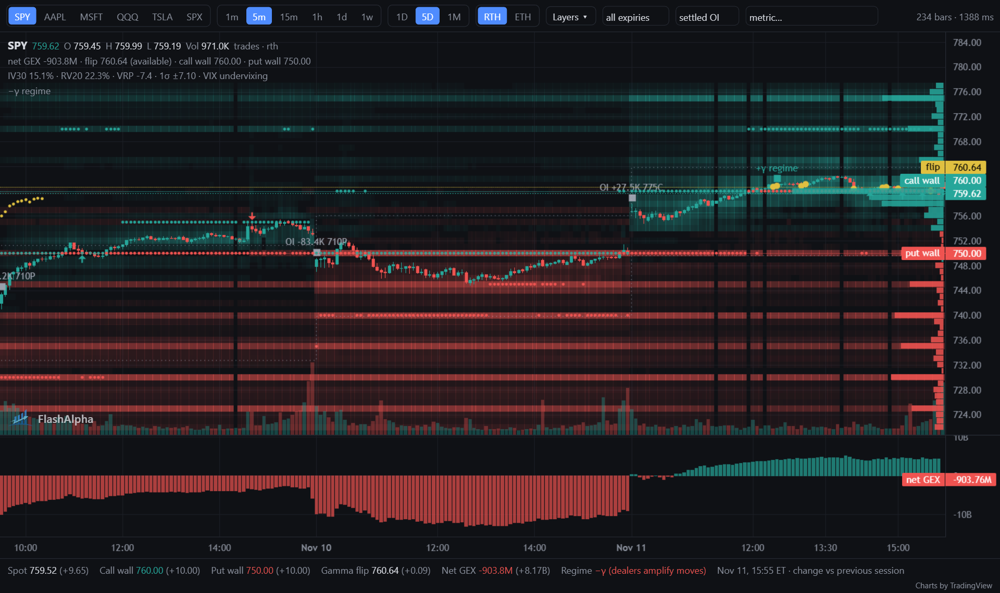
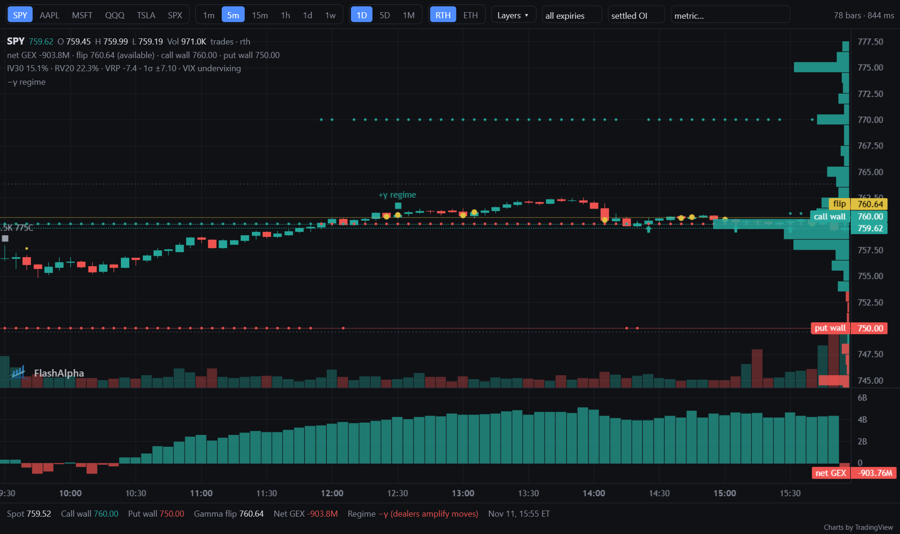
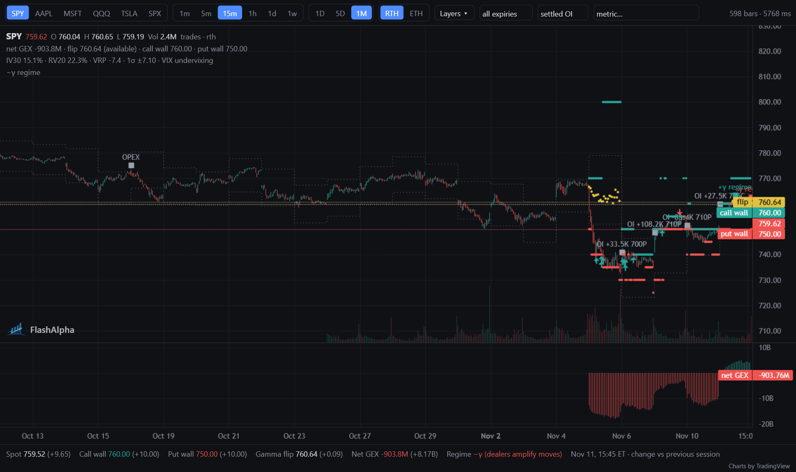

# Options GEX Charts: gamma exposure levels on a JavaScript candlestick chart

[](LICENSE)
[](https://github.com/tradingview/lightweight-charts)

An open-source, embeddable JavaScript candlestick chart that draws options gamma exposure (GEX) levels, the dealer gamma
levels, on the price: call wall, put wall, gamma flip, and max pain. It renders with
[TradingView Lightweight Charts™](https://github.com/tradingview/lightweight-charts) and reads data from the
[FlashAlpha](https://flashalpha.com/?utm_source=github&utm_medium=referral&utm_campaign=options-gex-charts) options analytics API or from your own backend.



**[Live demo](https://flashalpha-lab.github.io/options-gex-charts/)** ·
[Examples](examples) ·
[How GEX is computed](https://github.com/FlashAlpha-lab/gex-explained) ·
[Get a FlashAlpha API key](https://flashalpha.com/?utm_source=github&utm_medium=referral&utm_campaign=options-gex-charts)

## Features

- **Gamma exposure levels on the price:** call wall, put wall, gamma flip, and max pain, drawn per bar on the same time
  axis as the candles, so you can see how the price traded against each level.
- **Key levels as text:** spot, walls, flip, and max pain with their change since the previous session, readable by
  people and search engines.
- **Stock and index charts:** candlesticks and volume from 1-minute to weekly bars, regular or extended hours, on a US
  Eastern time axis.
- **Embeddable:** one `<div>` and one `<script>`. No build step and no framework. The chart fills its container.
- **Your own data:** pass a `source` object to draw GEX levels from any backend.
- **Plugins:** add your own layers, such as VWAP or custom levels, with `registerLayers`.
- **Light and dark:** `theme: 'light' | 'dark' | 'auto'` follows your page or the reader's system setting.
- **Mobile layout:** below 560 px the toolbar keeps the main buttons and moves the rest into the Layers menu; the key
  levels wrap into two columns.
- **MIT licensed.**

## Quick start with your own data

1. Load Lightweight Charts 5 and the chart core:

   ```html
   <script src="https://unpkg.com/lightweight-charts@5.0.0/dist/lightweight-charts.standalone.production.js"></script>
   <script src="src/flashalpha-chart-core.js"></script>
   ```

1. Add a container with a height. The chart fills the container and follows its size.

   ```html
   <div id="chart" style="height: 480px"></div>
   ```

1. Mount the chart with a `source` object. For the shape of the data, see [Use your own data](#use-your-own-data).

   ```html
   <script>
     const chart = FlashAlphaChart.mount(document.getElementById('chart'), {
       symbol: 'SPX',
       resolution: '5m',
       layers: ['levels', 'maxpain'],
       source: mySource,
     });
   </script>
   ```

For a complete page, open [`examples/custom-source.html`](examples/custom-source.html) in a browser.

## Use FlashAlpha data

To use FlashAlpha data, pass a FlashAlpha embed key instead of a `source` object:

```js
FlashAlphaChart.setLicenseKey('fa_pk_YOUR_EMBED_KEY');   // once per page, before mounting charts
FlashAlphaChart.mount(el, { symbol: 'SPX', resolution: '5m', baseUrl: 'https://charts.flashalpha.com' });
```

The chart sends the key in the `X-Api-Key` header. Anyone can read a key in your page source, so a page uses an **embed
key** (`fa_pk_…`), never your secret API key:

- it is read-only and works only for chart data;
- it works only on the domains you list when you create it;
- it carries your plan and expires (30 days by default, or as short as 5 minutes).

Create one from your server or a terminal with your secret API key:

```sh
curl -X POST https://charts.flashalpha.com/v1/embed-keys \
  -H "X-Api-Key: $FLASHALPHA_API_KEY" -H "Content-Type: application/json" \
  -d '{"domains": ["example.com"]}'
```

A site with its own backend can mint a short-lived key (`"ttl_seconds": 3600`) for each page view. The chart warns in the
browser console when a page uses a secret key.

The layers you get depend on your FlashAlpha plan. A layer above your plan shows a lock in the Layers menu and a link to
upgrade; layers you turned on that your plan doesn't include are named in an **Upgrade** box over the chart. The full API
(endpoints, payloads, errors) is in the [chart API reference](docs/api.md); lifetimes, delayed keys and errors are in
[Embed keys](docs/embed-keys.md).

## Embed a GEX chart in one line

The embed script loads Lightweight Charts and the chart core, then mounts every element that has the
`data-flashalpha-chart` attribute:

```html
<div data-flashalpha-chart data-symbol="SPX" style="height: 480px"></div>
<script async src="https://charts.flashalpha.com/embed.js" data-key="fa_pk_YOUR_EMBED_KEY"></script>
```

If your page adds charts after it loads, for example in a single-page app, call `FlashAlphaEmbed.scan()`.

| Attribute | Default | Description |
|---|---|---|
| `data-symbol` | Required | Ticker, for example `SPX` or `SPY`. |
| `data-key` | The script tag's `data-key` | Embed key for this chart. |
| `data-resolution` | `5m` | One of `1m`, `5m`, `15m`, `1h`, `1d`, `1w`. |
| `data-range` | Depends on resolution | Days to show, or `1D`, `5D`, `1M`, `6M`, `1Y`. |
| `data-theme` | `dark` | `dark`, `light`, or `auto`. |
| `data-upgrade-url` | FlashAlpha pricing | Where locked layers and the Upgrade button link. |
| `data-layers` | `levels` | Comma-separated layer IDs, for example `levels,maxpain`. |
| `data-session` | `rth` | `rth` for regular hours, `eth` to add pre-market and after-hours. |
| `data-controls` | `true` | `false` hides the toolbar. |
| `data-key-levels` | `true` | `false` hides the key levels text under the chart. |
| `data-background` | `#0f1115` | Chart background color. |
| `data-refresh` | `60` | Seconds between refreshes while the page is visible. `0` turns refresh off. |
| `data-base` | The script's host | Chart API root URL, for example when you use a proxy. |

On the `<script>` tag, `data-key` sets the key for every chart on the page, `data-layer-bundle="false"` skips the optional
layer bundle, and `data-debug="true"` shows load status. Lightweight Charts is loaded from unpkg pinned by an SRI hash.

## GEX layers

| Layer ID | What it draws |
|---|---|
| `levels` | Call wall, put wall, and gamma flip as step lines through the day. The flip is gray when the data source marks it as not certified. |
| `maxpain` | Max pain. |

After the last stored bar, the chart draws muted "spot" candles when the data source sends spot prices for those
minutes. The chart refreshes every 60 seconds while the page is visible and keeps your zoom.

### Pro layers: heatmap, GEX profile, 0DTE, replay

With a FlashAlpha embed key, the chart adds more layers from the FlashAlpha API, depending on your plan.

| Plan | Layers |
|---|---|
| Free | Candles and volume. |
| Basic | Call wall, put wall, gamma flip, max pain, 0DTE magnet, net GEX pane, vanna / charm / delta exposure panes. |
| Growth | Basic, plus the strike heatmap and GEX profile with gamma, delta, vanna and charm lenses (the profile with ticks where each strike stood 15 minutes earlier), session replay, 0DTE hedging flow, strike × expiry heatmap, 0DTE scope, level events, expected move (1σ band), and metrics (IV, 0DTE pin score, hedging estimates, and more). |
| Alpha | Growth, plus the live open interest basis. |





For all of them, see the [live demo](https://flashalpha-lab.github.io/options-gex-charts/).

## Options

`FlashAlphaChart.mount(element, options)` accepts these options:

| Option | Default | Description |
|---|---|---|
| `symbol` | First symbol with data | Ticker. |
| `resolution` | `5m` | One of `1m`, `5m`, `15m`, `1h`, `1d`, `1w`. |
| `days` | Depends on resolution | Number of days to show. Each resolution has a maximum. |
| `session` | `rth` | `rth` or `eth`. |
| `layers` | `['levels']` | Layer IDs: `levels`, `maxpain`, and IDs from registered layer plugins. |
| `controls` | `true` | `false` hides the toolbar. |
| `symbolButtons` | `true` | `false` hides the symbol buttons. |
| `exposure` | `true` | `false` draws candles only. |
| `keyLevels` | `true` | `false` hides the key levels text. |
| `source` | FlashAlpha | Your own data source. |
| `apiKey` | `setLicenseKey` value | FlashAlpha embed key (`fa_pk_…`). |
| `baseUrl` | Same origin | Chart API root URL. |
| `refresh` | `60` | Seconds between refreshes. `0` turns refresh off. |
| `theme` | `dark` | `dark`, `light`, or `auto` (follows the reader's system setting). |
| `background` | Per theme | Background color. You can also set the CSS variable `--fac-bg`. |
| `upgradeUrl` | FlashAlpha pricing | Where locked layers and the Upgrade box link. |
| `debug` | `false` | Shows load status in the toolbar. |
| `note` | Model-estimate disclaimer | A line under the chart next to the credit. `''` hides it. |
| `brand` | None | `{ logo, href, name }`: shows your logo, linked to `href`, under the chart instead of the TradingView logo on the chart, next to a "Charts by TradingView" link. |
| `lightweightCharts` | `window.LightweightCharts` | The Lightweight Charts module, if you import it instead of loading the script. |

`mount` returns an object with these members: `setSymbol(symbol)`, `setResolution(resolution)`, `setRange(days)`,
`setSession('rth' | 'eth')`, `setLayers([...])`, `setTheme(theme)`, `layers`, `plan`, `reload()`, `destroy()`, and `chart`
(the Lightweight Charts instance, for your own series). A chart whose element leaves the page stops refreshing.

When there's no data to draw, the chart shows a message and dispatches a `flashalpha:nodata` event on the container.
The event bubbles, and `event.detail` has `symbol` and `error`. For example, you can hide the chart's section:

```js
el.addEventListener('flashalpha:nodata', () => { el.closest('section').hidden = true; });
```

## Use your own data

Pass an object with the following methods as the `source` option. Each method can return a value or a promise.

```js
const mySource = {
  // Tickers the chart can show.
  symbols: () => [{ symbol: 'SPX', last_bar: '2026-11-10T21:00:00Z' }],

  // OHLCV bars.
  bars: (symbol, resolution, fromIso, toIso, session) => ({
    bars: [{ ts: '2026-11-10T14:30:00Z', open: 0, high: 0, low: 0, close: 0, volume: 0, source: 'mine' }],
  }),

  // Gamma exposure levels per bar.
  charts: (symbol, resolution, fromIso, toIso, { layers, session }) => ({
    exposure: [{
      ts: '2026-11-10T14:30:00Z',
      call_wall: 0, put_wall: 0, max_pain: 0,
      gamma_flip: { last: 0, status: 'available' },
    }],
  }),
};
```

- Times are UTC ISO 8601 strings. The chart shows them in US Eastern time.
- A `null` value is drawn as a gap, not as the previous value.
- A `gamma_flip.status` other than `available` draws the flip in gray.
- Levels are drawn on intraday resolutions (`1m` to `1h`).
- An exposure row can include `spot: { first, min, max, last }`. The chart then draws muted "spot" candles for minutes
  after the last bar.
- To report an error, return `{ error: 'message' }`. The chart shows the message instead of an empty chart.
- To lock layers by plan, return `plan` (`free`, `basic`, `growth`, `alpha`) from `charts`; layer plugins declare the
  plan each layer needs with `plans: { id: 'growth' }`.

## Add layers

To add layers to the Layers menu, call `FlashAlphaChart.registerLayers(plugin)` before `mount`. The layers apply to
every chart that you mount afterward. This example adds a VWAP line:

```js
FlashAlphaChart.registerLayers({
  layers: [['vwap', 'VWAP']],
  attach(ctx) {
    let line;
    return {
      ready() { line = ctx.chart.addSeries(ctx.LW.LineSeries, { color: '#4fc3f7', lineWidth: 1 }); },
      draw() {
        let pv = 0, v = 0;
        line.setData(!ctx.on('vwap') ? [] : ctx.bars.map(b => {
          pv += b.close * (b.volume || 0); v += b.volume || 0;
          return v ? { time: b.time, value: pv / v } : { time: b.time };
        }));
      },
      clear() { line.setData([]); },
    };
  },
});
```

A plugin has these fields:

- `layers`: an array of `[id, label]` pairs.
- `defaults` (optional): layer IDs that are on by default.
- `plans` (optional): the lowest plan per layer ID, for example `{ heatmap: 'growth' }`.
- `apiLayers(ctx)` (optional): extra API layers to request.
- `attach(ctx)`: runs once per chart and returns a handle with any of `ready()`, `draw(response)`, `clear()`,
  `legend(time, y)`, `crosshair(time, y)`, and `destroy()`. The handle can also have:
  - `legendLevels(row, parts)`: add text to the legend's levels line (`flip`, `call wall`, `put wall`, `max pain`)
    by inserting into or appending to `parts`.
  - `keyLevels(last, prev, items)`: add items to the key levels text under the chart by inserting into or appending
    to `items` (HTML strings: spot, call wall, put wall, gamma flip, max pain).
  - `methods`: an object of functions added to the chart object that `mount` returns, for example `setMyOption(x)`.

`ctx.setQuery({...})` adds parameters to the chart API request and reloads; called inside `attach` it only sets the
first request. A series that a plugin adds in a new pane under the price gets a fifth of the chart's height.

The header comment in [`src/flashalpha-chart-core.js`](src/flashalpha-chart-core.js) describes `ctx` and the handle
in full.

## FAQ

**What is gamma exposure (GEX)?**
GEX estimates how much options market makers' delta changes when the underlying price moves. It's summed over all
strikes from open interest and each option's gamma. It indicates how much stock dealers might need to buy or sell to
stay hedged.

**What is the call wall?**
The strike with the largest call gamma exposure. Dealer hedging near it tends to slow rallies, so traders often read it
as resistance.

**What is the put wall?**
The strike with the largest put gamma exposure. Traders often read it as support.

**What is the gamma flip?**
The price where net GEX changes sign. Above it, dealers are estimated to be long gamma, and their hedging dampens moves.
Below it, they are estimated to be short gamma, and their hedging can amplify moves.

**What is max pain?**
The strike at which open options would expire with the least total value for their holders.

**Is this a trading signal?**
No. The levels are model estimates from open interest, not observed dealer positions, and they aren't financial advice.

**Can I use the chart with my own backend?**
Yes. Pass a `source` object. You need a FlashAlpha key only for FlashAlpha data.

## Browser support

The chart supports current versions of Chrome, Edge, Firefox, and Safari on desktop and mobile. It needs ES2020 and
`Intl.DateTimeFormat` with time zone support.

## License and attribution

This project is licensed under the MIT License. See [LICENSE](LICENSE).

The chart loads [TradingView Lightweight Charts™](https://github.com/tradingview/lightweight-charts) at run time and
doesn't include its source code. Lightweight Charts is licensed under the Apache License 2.0:

> TradingView Lightweight Charts™
> Copyright (c) 2025 TradingView, Inc. https://www.tradingview.com/

The chart keeps the TradingView attribution logo, which is the Lightweight Charts default
(`layout.attributionLogo: true`). The logo meets the license requirement to link to tradingview.com. If you turn the
logo off, link to https://www.tradingview.com/ elsewhere on your page. If you bundle Lightweight Charts with your code,
include its LICENSE and NOTICE files.

The `brand` option turns the TradingView logo off and adds a "Charts by TradingView" link to https://www.tradingview.com/
under the chart instead. Keep that link if you change the chart's markup.

## Related projects

- [FlashAlpha](https://flashalpha.com/?utm_source=github&utm_medium=referral&utm_campaign=options-gex-charts): real-time options analytics API.
- [flashalpha-js](https://github.com/FlashAlpha-lab/flashalpha-js): JavaScript and TypeScript SDK.
- [flashalpha-python](https://github.com/FlashAlpha-lab/flashalpha-python): Python SDK.
- [gex-explained](https://github.com/FlashAlpha-lab/gex-explained): the theory and math behind GEX.
- [awesome-options-analytics](https://github.com/FlashAlpha-lab/awesome-options-analytics): a list of options analytics resources.
